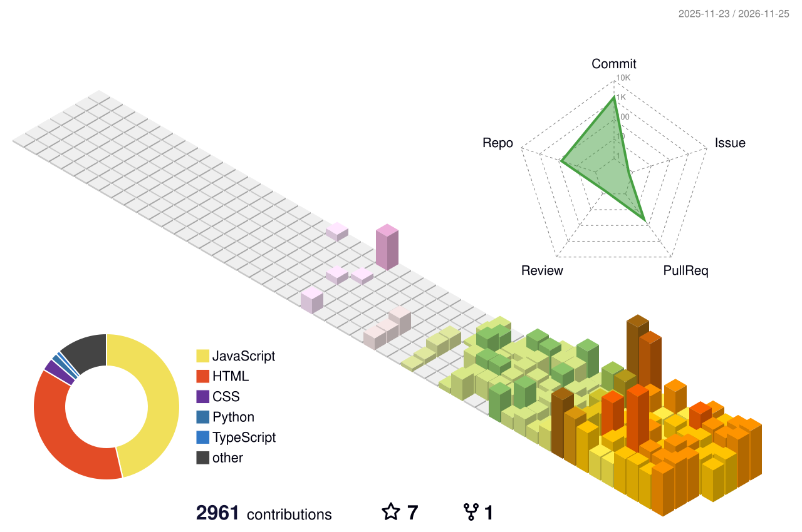

<!-- ============================================================ -->
<!--  ASHU DHANDA — GRAND PROFILE README                        -->
<!-- ============================================================ -->

<!-- BIG ANIMATED HEADER — Capsule Render, 300px, waving, twinkling -->

  

<!-- ANIMATED TYPING — Space Grotesk, cycling lines -->

  

 

<!-- BADGES / LINKS -->

  
  
  
  
  
  

 

---

## 👨‍💻 About Me

- 🚀 **Founder** — [aditiweb.tech](https://aditiweb.tech)
- 🔨 **Building** — deadcode-map, WebOS, School WhatsApp Bot, ClipForge
- 💡 **Belief** — build systems, break limits, ship daily

---

## 🌟 Featured Projects

| Project | What it is | Links |
| :--- | :--- | :--- |
| **deadcode-map** | Find dead code, prove it is dead, and see it on a map. JS/TS + Python, SAFE / REVIEW / KEEP grading, `--fix` and `--prove`, plus a web checker — paste a repo link and check dead code in the browser | [Live Web Checker](https://ashudhanda.github.io/deadcode-map/) · [Source](https://github.com/ashudhanda/deadcode-map) |
| **WebOS** | Browser-based desktop environment with interactive windows & custom UI | [Live](https://ashudhanda.github.io/webos/) · [Source](https://github.com/ashudhanda/webos) |
| **aditiweb.tech** | Web studio focused on modern dark interfaces | [Visit](https://aditiweb.tech) |
| **School WhatsApp Bot** | Multi-tenant school ERP over the official WhatsApp Business / Cloud API | [Source](https://github.com/ashudhanda/school-whatsapp-bot) |
| **ClipForge** | Short-form video tooling | [Source](https://github.com/ashudhanda/clipforge) |

---

## 🛠️ Tech Stack

  

 

  
  
  
  
  
  
  
  
  
  

---

## 📊 GitHub Analytics

  
  

 

  

---

## 📈 Activity Graph

  

---

## 🐍 Contribution Snake

<picture>
  <source media="(prefers-color-scheme: dark)" srcset="https://raw.githubusercontent.com/ashudhanda/ashudhanda/output/github-snake-dark.svg" />
  <source media="(prefers-color-scheme: light)" srcset="https://raw.githubusercontent.com/ashudhanda/ashudhanda/output/github-snake.svg" />
  
</picture>

---

## 🏙️ 3D Contribution Graph

  <picture>
    <source media="(prefers-color-scheme: dark)" srcset="https://raw.githubusercontent.com/ashudhanda/ashudhanda/main/profile-3d-contrib/profile-season-animate.svg" />
    <source media="(prefers-color-scheme: light)" srcset="https://raw.githubusercontent.com/ashudhanda/ashudhanda/main/profile-3d-contrib/profile-green-animate.svg" />
    
  </picture>

---

<!-- BIG ANIMATED FOOTER — Capsule Render, 200px, waving -->

  

  <b>Thanks for visiting — build systems, break limits, ship daily.</b>

